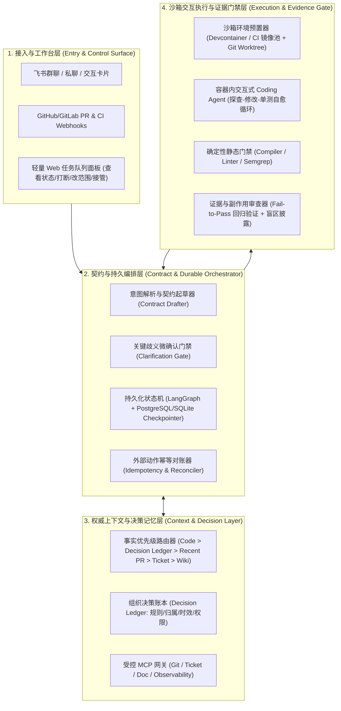

# AI 研发数字员工系统 — 架构设计与技术规范 (Design & Spec v2.0)

**文档版本**：v2.0.0（融合 Antigravity & Codex 深度评审重制版）  
**状态**：Ready for V1 Implementation  
**核心北极星指标（Governing Question）**：  
> *“我能否把一项真实的研发工作委托给它，然后彻底不再惦记，最终要么收到一份证据确凿、可直接合入的交付物，要么收到一个极其精准、只需我做最小决策的提问？”*

**一句话定位**：驻扎在企业飞书与私有 Git 环境中的**可信研发委托系统（Dependable Engineering Delegation System）**。它将碎片化的群聊请求转化为具备明确边界的**任务契约（Task Contract）**，在对齐关键业务歧义后，通过受控容器内的交互式编码循环、可复现回归测试证据链与组织决策记忆，交付低审查负担的确定性代码变更与故障诊断。

---

## 0. 核心设计哲学升级（从 v1.1 到 v2.0 的范式转变）

| 维度 | v1.1 旧范式（需摒弃的“伪自动化”） | v2.0 新范式（可信赖的工程委托） |
| :--- | :--- | :--- |
| **任务启动** | 意图分类置信度高就直接写代码 | **契约先行（Task Contract First）**：先推断目标、范围、证据与排除项；仅在遇到实质性影响正确性的歧义时发出“5 秒微确认” |
| **知识沉淀** | 模仿个人文风 + 把人工修改 Diff 直接塞向量库 | **组织决策账本（Decision Ledger）**：区分“临时妥协（Workaround）”与“团队规范（Approved Policy）”，记录归属人、时效与事实优先级 |
| **编码执行** | 状态机拼 Prompt 生成完整 Diff -> 丢容器跑测试 | **受控容器内交互式 Agentic Loop**：复刻成熟 Coding CLI 模式，在预置环境的沙箱内边探测、边小步修改、边跑单测 |
| **质量门禁** | 3 个 LLM Reviewer 互相挑刺，综合打分 `>= 85` 放行 | **证据驱动门禁（Evidence-Based Gate）**：确定性静态工具（Lint/Semgrep）拦截格式与安全 + **Fail-to-Pass 回归测试** + 未验证边界显式披露 + 1 个专注于 AC 与副作用的审查器 |
| **交付终点** | 创建出 GitHub Draft PR 即视为成功 | **全生命周期跟进（Follow-Through）**：涵盖 PR 评论追改、CI 失败自愈、中途打断/改范围、无法完成时的结构化交接（Handoff），以**净节省人工时间（Net Human Time Saved）**衡量成败 |
| **演进节奏** | 按功能堆砌划分 V1~V6（一上来就做全套） | **按证据门禁演进（Evidence-Gated Stages）**：单仓单工作流自用验证 -> 团队共享队列与决策库 -> 外部高价值切入点（只读告警诊断/单测补齐） -> 商业化平台 |

---

## 1. 项目背景、目标与安全边界 (Goals & Guardrails)

### 1.1 核心痛点
1. **委托摩擦高（Delegation Friction）**：工作始于飞书群聊/报错截图，但要完成它，必须有人去拼装上下文、明确边界、做业务决定、改代码、写验证并跟进 Review。
2. **上下文与历史决策流失**：历史 Wiki 经常过期，团队“为什么不用方案 A”、“哪个字段有历史兼容包袱”散落在老员工脑子里和历史 PR 评论中。
3. **虚假自动化制造更多返工**：普通 AI 编程工具或盲目提 PR 的机器人，往往在错误理解需求的前提下写出“能跑通自己写的测试”的错误代码，导致人类审查与返工成本高于自己亲手写。

### 1.2 核心目标 (Goals)
1. **端到端可信委托闭环**：围绕“任务契约生成 -> 关键歧义微对齐 -> 沙箱交互式修复与回归验证 -> 证据报告生成 -> PR 评论持续跟进”构建闭环。
2. **正的净人工时间节省（Positive Net Human Time Saved）**：
   $$\text{Net Time Saved} = \text{Baseline Human Effort} - (\text{Clarification} + \text{Supervision} + \text{Review} + \text{Rework})$$
   在 V1 阶段即内置埋点，确保系统真正帮开发者省时间，而不是制造审查噪音。
3. **物理级安全与权限隔离**：在架构层面（而非 Prompt 层面）强制执行分支权限、网络隔离、凭据脱敏与防注入。

### 1.3 严格非目标与安全消除项 (Non-Goals & Hard Boundaries)
* **禁止直接合入与生产变更**：系统物理无权向受保护分支（`main`/`master`/`release`）执行 Merge 或 Push。飞书卡片上的“一键合入”必须跳转至 Git 平台由人类基于自身 OAuth 身份操作，或调用独立的、校验人类签名授权的审批网关。
* **明确区分推理数据流模式**：
  * **本地/专有云模式（Intranet-Only Mode）**：对接内网部署的开源模型（Qwen-Coder / DeepSeek）或企业专属 VPC 模型实例，源码与文档 100% 不出内网。
  * **云端 API 模式（Cloud API Mode）**：对接公有云模型 API 时，强制经过 DLP 脱敏网关（剥离密钥、内部域名、PII 数据）并签订零数据保留（Zero Data Retention）协议，绝不虚假宣传“用公有云 API 但数据不出内网”。
* **防提示词注入（Prompt Injection Defense）**：所有外部拉取的 Jira 描述、群聊记录、Wiki 文档、日志堆栈均视为**不可信数据输入（Untrusted Input）**，使用结构化 XML 标签隔离，且高危操作（如修改 CI 配置、修改权限文件、外发网络请求）在沙箱与 MCP 层通过硬编码策略拦截。

---

## 2. 系统总体架构设计 (System Architecture v2.0)



---

## 3. 核心技术规范 (Technical Specification)

### 3.1 一等公民：任务委托契约 (`TaskContract`)

在写任何一行代码前，系统必须先从上下文推断并生成结构化的 `TaskContract`。**只有在存在实质性影响正确性或范围的未决问题时，才向人类提问（最多不超过 2 个选择题/简答题）**：

```python
from typing import TypedDict, List, Literal, Optional, Dict

class UnresolvedDecision(TypedDict):
    question: str                  # 例如："已过期的订单在触发回滚时，状态应回到 PENDING 还是保持 EXPIRED？"
    options: List[str]             # 供用户在飞书卡片一键点击的选项
    default_assumption: str        # 若用户直接点“按默认继续”时采用的假设
    impact_scope: str              # 该决策影响的模块或行为

class TaskContract(TypedDict):
    contract_version: int
    objective: str                 # 明确的一句话目标
    target_repo: str               # 目标仓库
    base_branch: str               # 基线分支
    base_commit_sha: str           # 锁定的基线 Commit SHA
    reproduction_evidence: str     # 复现路径、报错堆栈或期望失败的测试用例
    acceptance_criteria: List[str] # 明确可验证的验收标准列表
    permitted_scopes: List[str]    # 允许修改的目录/模块白名单
    out_of_scope: List[str]        # 明确禁止触碰的边界（如：禁止修改 DB Schema、禁止改支付核心逻辑）
    unresolved_decisions: List[UnresolvedDecision]
    max_budget_usd: float          # 成本上限（默认 $1.50）
    owner_id: str                  # 责任研发标识
```

### 3.2 持久化任务状态与恢复模型 (`DurableTaskState`)

摒弃纯内存字典或仅靠 Redis 简单重试的做法。大体积日志与 Diff 产物存储在对象存储/本地卷中，状态机仅保存引用 URI，并通过关系型数据库持久化每个 Step 的 Checkpoint：

```python
FailureClass = Literal[
    "NONE",
    "TRANSIENT_INFRA",          # 网络超时、API 限流 -> 指数退避自动重试
    "SANDBOX_ENV_BROKEN",       # 镜像缺依赖、私有源不可达 -> 立即中止并告警平台维护者
    "REGRESSION_TEST_FAILED",   # 业务单测未通过 -> 进入沙箱自愈循环（上限 3 次）
    "REQUIREMENT_AMBIGUITY",    # 执行中发现核心需求矛盾 -> 挂起并向人类发起精准提问
    "CONCURRENT_CONFLICT",      # 基线分支发生冲突更新 -> 自动 Rebase 或请求人工介入
    "BUDGET_OR_LOOP_EXCEEDED"   # 超出预算或重试上限 -> 打包结构化交接报告 (Handoff Bundle)
]

class VerificationEvidence(TypedDict):
    verified_commit_sha: str
    repro_test_failed_on_base: bool   # 证明回归测试在基线代码上确实复现了 Bug (Fail-to-Pass)
    repro_test_passed_on_head: bool   # 证明修复后该测试通过
    existing_test_suite_passed: bool  # 原有关联测试套件全部通过
    tests_weakened_check: bool        # 静态检查确认未删除断言、未加 @skip、未放宽校验来骗过测试
    static_analysis_passed: bool      # Linter / Typecheck / Semgrep 结果
    unverified_risks: List[str]       # 诚实披露沙箱未能覆盖的验证项（如："未联调第三方支付沙箱"）
    artifact_log_uri: str             # 完整执行日志外部存储 URI

class DurableTaskState(TypedDict):
    # 1. 租户与身份隔离
    tenant_id: str
    workspace_id: str
    task_id: str
    trace_id: str
    
    # 2. 契约与生命周期状态
    contract: TaskContract
    lifecycle_status: Literal[
        "DRAFTING_CONTRACT",
        "WAITING_CLARIFICATION",
        "QUEUED",
        "RUNNING_IN_SANDBOX",
        "VERIFYING_EVIDENCE",
        "PR_OPEN_FOLLOWING_UP",    # PR 已提，持续监听评论与 CI
        "HANDED_OFF_INCOMPLETE",   # 无法独立完成，已输出半成品与排查结论交接给人
        "ACCEPTED_AND_CLOSED",
        "ABANDONED_OR_REVERTED"
    ]
    
    # 3. 幂等与外部副作用账本 (防崩溃重复创建)
    recorded_operations: Dict[str, str]  # 如 {"create_branch": "sha", "create_draft_pr": "pr_402"}
    
    # 4. 产物引用与证据报告
    head_commit_sha: Optional[str]
    patch_artifact_uri: Optional[str]
    verification_evidence: Optional[VerificationEvidence]
    deliverable_pr_url: Optional[str]
    
    # 5. 故障分类与成本计量
    failure_class: FailureClass
    failure_reason: Optional[str]
    sandbox_attempt_count: int
    total_cost_usd: float
    human_interaction_seconds: int       # 累计耗费人类的确认与回复时间
```

### 3.3 证据驱动的质量门禁（取代 `score >= 85` 玄学打分）

代码变更能否推送给人类，不取决于多个 Agent 给出 `85` 还是 `92` 的主观打分，而取决于以下**硬性证据清单（Evidence Checklist）**：

1. **Fail-to-Pass 回归证明（核心防幻觉机制）**：
   * 针对 Bug 修复任务，Coding Agent 必须先编写或更新一个能复现该 Bug 的单元测试，在 `base_commit_sha` 上运行并确认其 **FAIL**，然后在应用修复代码后的 `head_commit_sha` 上运行并确认其 **PASS**。
2. **反作弊校验（Anti-Tampering Check）**：
   * 规则扫描器自动检查测试文件的 Diff：严禁通过删除已有 `assert`、添加 `@pytest.mark.skip` / `.skip()`、捕获异常不处理或扩大 mock 范围来强行让测试变绿。
3. **单审查器聚焦模式（Focused Single Reviewer）**：
   * V1 阶段仅启用 **1 个高推理能力 Reviewer Agent**，禁止其挑剔代码排版格式（由 Linter 强制格式化），只回答三个问题：
     1. 改动是否完整覆盖了 `TaskContract.acceptance_criteria`？
     2. 是否违反了 `DecisionLedger` 中的团队历史约束？
     3. 哪些边界因为在沙箱内无法模拟而**未被验证**？（必须写入卡片的 `Unverified Risks` 栏，向人类诚实披露）。

### 3.4 权威上下文层级与组织决策账本 (`Truth Hierarchy & Decision Ledger`)

#### 1. 事实优先级（解决过期文档误导）
当不同来源的信息发生冲突时，Agent 严格遵守以下采信优先级：
1. **当前仓库主干代码与生效中的测试用例**（权威度 100%）
2. **组织决策账本（`DecisionLedger`）中状态为 `APPROVED` 的架构/业务约束**（权威度 95%）
3. **最近 90 天内合入的关联 PR 描述与 Review 结论**（权威度 85%）
4. **当前任务契约中人类确认的指令**（权威度 80%）
5. **历史飞书 Wiki / 旧设计文档**（仅供参考，发现与代码冲突时必须在报告中提示“疑似文档过期”）

#### 2. 组织决策账本（取代无脑向量化人工 Diff）
不将人类的每次代码修改盲目当作永久规则。每条沉淀到仓库 `.ai/DECISIONS.yaml` 或数据库的记录必须包含完整元数据：
```yaml
- id: DEC-2026-014
  scope: "order-service/src/rollback/*"
  rule: "订单回滚严禁直接调用支付网关同步退款接口，必须写入 outbox 表由异步 Worker 消费"
  reason: "防止第三方支付网关抖动拖垮核心订单库事务连接池（见事故复盘 INC-892）"
  status: "APPROVED_POLICY" # 区分 APPROVED_POLICY 与 ONE_OFF_WORKAROUND
  owner: "zhangsan@company.com"
  verified_at: "2026-11-05"
  visibility_rbac: "team-order"
```
当人类修改了 Agent 的 PR 时，系统在归档时向人类发送一条轻量询问：*“检测到你将同步调用改为了 Outbox 异步写入，是否将其记入 `order-service` 长期团队规则？”* 仅在人类点“是”后才升级为正式策略。

### 3.5 沙箱环境契约与持久化恢复 (Sandbox & Operational Recovery)

1. **沙箱环境预置契约（解决“跑不起单测”问题）**：
   * 接入仓库通过 `.digital-employee/sandbox.yaml`（或直接复用现有 GitLab CI / GitHub Actions 测试镜像）声明基础镜像、私有依赖源挂载（只读代理 Token）、Mock 依赖服务（如 SQLite/Testcontainers）及单测启动命令。
   * 容器运行时强制约束：`--network=isolated-mock-net`（禁连公网与生产内网）、CPU/Memory 配额限制、只读挂载全局依赖缓存以实现 5 秒内热启动。
2. **外部副作用幂等与崩溃恢复（Durable Recovery）**：
   * 所有外部写操作（创建分支、推送 Commit、创建 Draft PR、发飞书卡片）必须携带确定性的 `idempotency_key = hash(task_id + step_name + contract_version)`。
   * 若 Worker 在推送分支后、记录 PR URL 前崩溃，重启后 `Reconciler` 先查询 Git 平台是否已存在 `ai-agent/{task_id}` 的 Open PR，实现无缝接续而非重复建单。
   * 若任务中途被人类点击“取消/修改需求”或超出重试上限，系统不会直接丢弃现场，而是生成一份 **结构化交接包（Handoff Bundle）**：包含已排查出的根因线索、尝试过的修复分支链接、失败的测试日志摘要，确保人类接手时零重复劳动。

### 3.6 委托人交互体验与下半场跟进 (Delegator UX & Follow-Through)

1. **聊天入口 + 轻量 Web 控制台**：
   * **飞书端**：负责发起委托、5 秒微确认卡片、最终证据报告卡片、PR 评论线程直接对话。
   * **轻量 Web 队列面板**：展示当前属于我的任务列表（`运行中` / `等我拍板` / `待审阅 PR` / `已交接`），支持随时一键 **暂停、取消、追加上下文、修改范围**。
2. **PR 创建后的持续跟进（Post-PR Loop）**：
   * 监听 GitHub/GitLab `pull_request_review_comment` 与 `check_suite` 事件。
   * 人类在 PR 某行代码下评论：*“这里改成批量查询”* -> 系统自动唤醒对应 `worktree`，增量修改代码、重跑验证并 push 新 commit，在评论下回复验证结果。

---

## 4. 首版度量体系与评测基准（V1 即内置，拒绝无依据估算）

将原有的“接管 30%~40% 工作、耗时从 30 分钟降到 3 分钟”明确标记为**待验证假设（Hypotheses）**，并在 V1 第一天上线以下真实度量指标：

1. **漏斗转化率**：`发起委托数 -> 契约确认数 -> 证据门禁通过数 -> PR 被无大改合入数 (Accepted without heavy rework) -> 合入后 7 天内未回滚数`。
2. **净节省时间核算**：每次任务结束时记录 `Agent 端到端耗时`、`人类微确认耗时`、`人类最终 Review 与补改耗时`，与同类历史工单基线对比。
3. **20 题黄金回放集（Golden Historical Eval Set）**：
   * 从目标仓库过去 3 个月已解决的真实 Bug 中挑选 20 个，仅保留修复前的代码 Commit 与当时的工单/群聊原始信息，作为基准评测集，对比“裸用 Coding CLI”与“本系统”的一次修复通过率与人类干预次数。

---

## 5. 证据门禁驱动的演进路线图 (Evidence-Gated Roadmap)

彻底摒弃按功能脑暴排布的 V1~V6，改为**只有当前阶段拿到硬核数据证据，才解锁下一阶段**：

| 演进阶段 | 聚焦范围与核心构建内容 | 解锁下一阶段所需的硬核证据 (Exit Criteria) |
| :--- | :--- | :--- |
| **Stage 1：个人高粘性外挂**<br>*(第 1~3 周)* | **极窄切口**：仅支持 **1 个飞书入口 + 1 个 Git 仓库 + 有明确边界的常规 Bug 修复**。<br>跑通：任务契约微确认 -> 容器内交互式编码 -> Fail-to-Pass 回归测试验证 -> 证据报告卡片 -> PR 评论追改。<br>*（注：工单关联为可选，Spec 撰写仅作为编码前的内部准备步骤，不单独作为产品发布）* | 1. 在 20 个真实日常任务中，你本人**自愿重复使用**它处理生产任务；<br>2. PR 无需人工大改的采纳率 **> 65%**；<br>3. 经测算你的**净人工时间节省 > 0**。 |
| **Stage 2：单团队共享与记忆沉淀**<br>*(第 4~8 周)* | 引入 **轻量 Web 任务队列**、**组织决策账本 (`DecisionLedger`)**、**仓库 10 分钟自动入驻脚本 (Auto-Onboarding)**、**私聊预览影子模式 (Shadow Mode)** 以及持久化恢复机制。 | 1. 团队内 **3~5 名其他工程师**在没有你代操作的情况下独立委托成功；<br>2. 决策账本成功拦截至少 5 次历史同类设计错误；<br>3. 未发生任何越权或污染主干分支事件。 |
| **Stage 3：高价值运营场景扩展**<br>*(第 3~4 个月)* | 解锁 **只读模式的线上告警秒级诊断（Read-Only Oncall Diagnosis）** 与 **受控配额的核心模块单测补齐**。<br>*（严控夜间自动提 PR 数量，必须根据人类团队每日 Review 消化容量动态限流，绝不制造新的 PR 积压）* | 1. 告警故障定位准确率 > 75%，且显著缩短真实故障定位耗时（MTTD）；<br>2. 补充的单测真实捕获到边界缺陷，而非刷覆盖率数字。 |
| **Stage 4：外部种子客户商业化验证**<br>*(第 5~6 个月)* | **精准商业定位**：面向使用“飞书 + 私有 GitLab/GitHub”的研发团队，提供**“保留团队决策记忆、具备完整验证证据链与审计历史的私有化研发委托系统”**。<br>收敛连接器矩阵（先打透 1 套标准技术栈），固化一键部署包与 RBAC 审计台。 | 1. 至少 **2 家外部独立团队**完成私有化部署并持续周活使用；<br>2. 客户认可其节省的排障与交付成本远超软件订阅与维护成本，完成首单付费。 |
